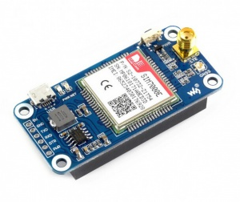
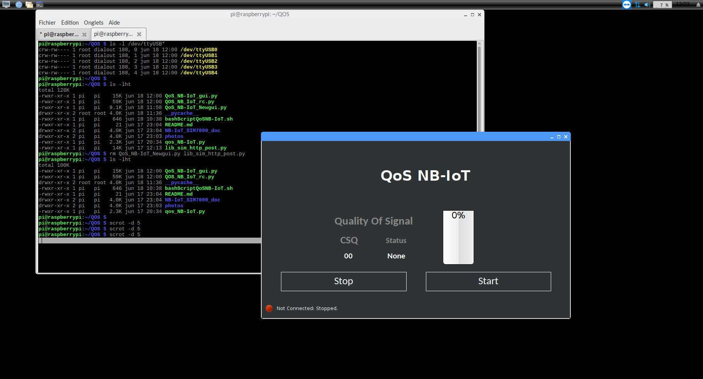

# QoS NB-IoT — SIM7000E Signal Quality Monitor

Python tools to measure and report the **Quality of Signal (QoS)** of an **NB-IoT** connection using a **Waveshare SIM7000E NB-IoT HAT** on a Raspberry Pi. Built to qualify NB-IoT coverage at installation sites of connected IoT devices before deployment.

<p align="center">
  
</p>

## Features

- **Signal strength monitoring** with `AT+CSQ`, rated as *Marginal* / *OK* / *Good* / *Excellent*
- **PyQt5 touchscreen GUI** with Start/Stop control, a live CSQ value, a signal gauge and connection status
- **Network attach & PDP context**: registration (`AT+CREG`), GPRS attach (`AT+CGATT`), APN setup and IP retrieval
- **Telemetry upload** of the signal quality as JSON over **UDP** or **HTTP** to a remote server
- **Time sync**: sets the Raspberry Pi system clock from the network time (`AT+CCLK?`)
- **Power control** of the SIM7000E via GPIO (power on / power off)
- **Watchdog script** that restarts the GUI if it is not running

## Hardware

| Component | Details |
|-----------|---------|
| Board | Raspberry Pi (Raspbian) |
| Modem | Waveshare SIM7000E NB-IoT HAT (LTE Cat-NB1 / Cat-M1) |
| Interface | UART `/dev/ttyAMA0` (or USB `/dev/ttyUSB*`), 9600 baud |
| Power key | GPIO 4 (BCM) |

The modem manual and schematic are in [`NB-IoT_SIM7000_doc/`](NB-IoT_SIM7000_doc/).

## Screenshot



## Project Structure

| File | Purpose |
|------|---------|
| `QoS_NB-IoT_gui.py` | PyQt5 GUI application (main app) |
| `QOS_NB_IoT_rc.py` | Qt resources (icons) |
| `qos_NB-IoT.py` | Command-line signal quality monitor |
| `nbiot_connect.py` | Attach to the network and get an IP address |
| `send_udp*.py`, `udp_signal_sender.py` | Send signal quality as JSON over UDP |
| `connect_send_http.py`, `get_http_message.py` | Send / receive data over HTTP |
| `set_systemtime_nbiot.py`, `settimezone_nbiot.py`, `get_utc-date-time.py` | Network time synchronization |
| `sim7000e_power_control.py` | GPIO power control of the modem |
| `run.sh`, `bashScriptQoSNB-IoT.sh` | Start-up and watchdog scripts |
| `AT_Commands`, `NBIoT_connection_get_IP` | Reference AT command sessions |
| `power_consumption` | Power budget notes |
| `Manual_QoS_NB-IoT_06-2019.pdf` | User manual |

## Getting Started

```bash
# Dependencies
sudo apt install python3-pyqt5
pip3 install pyserial RPi.GPIO

# Power on the modem
python3 sim7000e_power_control.py power_on

# Command-line monitor
python3 qos_NB-IoT.py

# GUI
python3 QoS_NB-IoT_gui.py
```

> Set the serial port and APN (default `shared.m2m.ch`) in the scripts to match your setup and SIM provider.

## Signal Quality Scale (CSQ)

| CSQ | Rating |
|-----|--------|
| 0 – 9 | Marginal |
| 10 – 14 | OK |
| 15 – 19 | Good |
| 20 – 30 | Excellent |

## Tech Stack

Python 3 · PyQt5 · pySerial · RPi.GPIO · AT commands · NB-IoT / LTE-M · UDP / HTTP · Bash · Raspberry Pi

## Author

**Akram M'Tir**, [@amtir](https://github.com/amtir)
