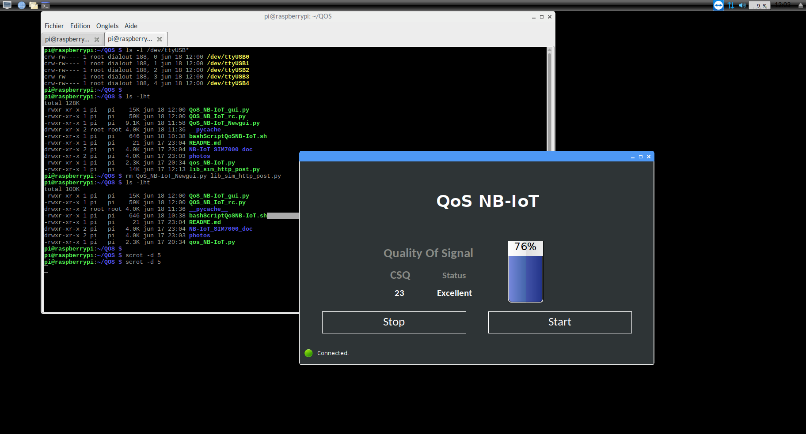

# QoS NB-IoT — SIM7000E Signal Quality Monitor

Python tools to measure and report the **Quality of Signal (QoS)** of an **NB-IoT** connection using a **Waveshare SIM7000E NB-IoT HAT** on a Raspberry Pi. Built to check NB-IoT coverage at a site before deploying connected IoT devices there.

<p align="center">
  
</p>

## Features

- **Signal strength monitoring** with `AT+CSQ`, rated as *Marginal* / *OK* / *Good* / *Excellent*
- **PyQt5 touchscreen GUI** with Start/Stop control, a live CSQ value, a signal gauge and connection status
- **Network attach & PDP context**: registration (`AT+CREG`), GPRS attach (`AT+CGATT`), APN setup and IP retrieval
- **Telemetry upload** of the signal quality as JSON over **UDP** or **HTTP** to a remote server
- **Time sync**: sets the Raspberry Pi system clock from the network time (`AT+CCLK?`)
- **Power control** of the SIM7000E via GPIO (power on / power off)
- **Watchdog script** that restarts the GUI if it is not running

## Screenshot

<p align="center">
  
</p>

## Hardware

| Component | Details |
|-----------|---------|
| Board | Raspberry Pi (Raspbian) |
| Modem | Waveshare SIM7000E NB-IoT HAT (LTE Cat-NB1 / Cat-M1) |
| Interface | UART `/dev/ttyAMA0` (or USB `/dev/ttyUSB*`), 9600 baud |
| Power key | GPIO 4 (BCM) |

## Signal Quality Scale (CSQ)

| CSQ | Rating |
|-----|--------|
| 0 – 9 | Marginal |
| 10 – 14 | OK |
| 15 – 19 | Good |
| 20 – 30 | Excellent |

## Repository Structure

```
.
├── src/
│   ├── QoS_NB-IoT_gui.py          # PyQt5 GUI application (main app)
│   ├── QOS_NB_IoT_rc.py           # Qt resources (icons)
│   ├── qos_NB-IoT.py              # Command-line signal monitor
│   ├── nbiot_connect.py           # Network attach + IP address
│   ├── send_udp.py, udp_signal_sender.py          # Signal quality → JSON over UDP
│   ├── connect_send_http.py, get_http_message.py  # HTTP send / receive
│   ├── set_systemtime_nbiot.py, settimezone_nbiot.py, get_utc-date-time.py  # Network time
│   ├── sim7000e_power_control.py  # GPIO power on/off
│   └── experiments/               # Earlier iterations of the UDP sender
├── scripts/
│   ├── run.sh                     # Start the UDP sender at boot
│   └── bashScriptQoSNB-IoT.sh     # Watchdog: restart the GUI if it stopped
├── docs/
│   ├── SIM7000E-NB-IoT-HAT-Manual-EN.pdf, ...-Schematic.pdf
│   └── notes/                     # AT-command sessions, power budget
├── logs/nbiot.log                 # Sample run
├── photos/                        # Hardware and GUI screenshots
└── requirements.txt
```

## Getting Started

```bash
sudo apt install python3-pyqt5
pip3 install -r requirements.txt

python3 src/sim7000e_power_control.py power_on   # power on the modem
python3 src/qos_NB-IoT.py                        # command-line monitor
python3 src/QoS_NB-IoT_gui.py                    # GUI
```

> Set the serial port and APN (default `shared.m2m.ch`) in the scripts to match your setup and SIM provider. The UDP/HTTP scripts have the target server address in their `AT+CIPSTART` commands; change it to your own endpoint.

## Tech Stack

Python 3 · PyQt5 · pySerial · RPi.GPIO · AT commands · NB-IoT / LTE-M · UDP / HTTP · Bash · Raspberry Pi

## Author

**Akram M'Tir**, [@amtir](https://github.com/amtir)
